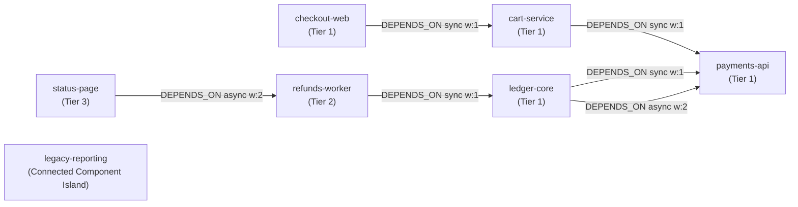

# CodePulse: Database-First Implementation Plan
**Breaking-Change & PR Blast-Radius Governor + Engineering Company Brain**

> [!IMPORTANT]
> **Core Architectural Rule:** The LLM **never** writes or guesses Cypher queries at runtime. Every database schema, index, entity resolver, and parameterized Cypher query is authored, profiled with `GRAPH.EXPLAIN`, and verified in FalkorDB Browser in **Phase 1** before a single line of agent or UI code is written.

---

## 1. System Architecture & How the Tools Fit Together

CodePulse combines all **3 Hackathon Tracks** into one cohesive workflow using FalkorDB Cloud (or local Docker `falkordb/falkordb:latest`), `GraphRAG-SDK`, and `FalkorDB-MCPServer`:

```mermaid
flowchart TD
    subgraph Offline["Phase 1 & 2: Schema & Knowledge Ingestion (Setup Time)"]
        SEED["seed.py (Deterministic Graph Schema + Indexes)"] --> FDB[("FalkorDB Multigraph\ncodepulse:{tenant_id}")]
        DOCS["Unstructured Docs\n(ADRs, Slack Threads, Postmortems)"] --> GRAG["FalkorDB GraphRAG-SDK\n(Strict Ontology Extraction)"]
        GRAG -->|Merges Verified Nodes/Edges| FDB
    end

    subgraph Runtime["Phase 3, 4 & 5: Runtime Agent Loop (Zero LLM-Generated Cypher)"]
        PR["Incoming PR / Architecture Query"] --> ORCH["Multi-Agent Orchestrator\n(3 Specialized Agents)"]
        ORCH <-->|Typed Tool Calls Only| MCP["CodePulse MCP Server\n(Built on FalkorDB-MCPServer Pattern)"]
        MCP -->|1. resolve_entity()| FDB
        MCP -->|2. Fixed Parameterized ro_query / algo.*| FDB
        MCP -->|3. Controlled Memory Writes| FDB
        ORCH --> GUARD["Post-Generation Verifier\naccepts(sentence, answer)"]
        GUARD --> UI["Explainable Trace + Visual Path Output"]
    end
```

### Role of the Two GitHub Repositories
1. **[FalkorDB/GraphRAG-SDK](https://github.com/FalkorDB/GraphRAG-SDK) (Used Strictly for Corpus Ingestion — Track 03):**
   * Per the reference guide: *"If your idea starts from a corpus rather than a schema, start at GraphRAG-SDK instead and let it build the graph for you."*
   * We use `GraphRAG-SDK` with a **locked Ontology** during ingestion to turn unstructured engineering markdown files (Architecture Decision Records, Slack debate transcripts, Incident Postmortems) into structured `:ADR`, `:SlackThread`, and `:Rule` nodes linked to `:Service` nodes.
   * We **do not** use open-ended text-to-Cypher generation in the live agent loop.
2. **[FalkorDB/FalkorDB-MCPServer](https://github.com/FalkorDB/FalkorDB-MCPServer) (Used as the MCP Protocol Foundation — Track 01 & 02):**
   * Instead of exposing a generic `query_graph(cypher_string)` tool where the LLM writes raw Cypher, we customize/wrap the MCP Server to expose **10 fixed, typed, human-authored Cypher tools** (plus `list_graphs` for tenant switching).

---

## 2. FalkorDB Known Limitations Checklist (Enforced in Phase 1)

Every query in this plan is explicitly engineered around the four documented FalkorDB Cypher limitations:

| Limitation | How It Breaks Naive Queries | Mandatory CodePulse Rule |
| :--- | :--- | :--- |
| **1. Relationship Uniqueness in Patterns** | If an edge alias isn't referenced elsewhere in the query, FalkorDB only checks that *at least one* edge exists between two nodes, ignoring parallel edges (e.g., synchronous REST + async Kafka between two services). | Always bind edge aliases (`[r:DEPENDS_ON]`) and reference them in `WHERE ID(r) >= 0` or return edge properties (`r.kind`, `r.weight`). For variable-length paths, use `[r IN relationships(path) | r.kind]`. |
| **2. `LIMIT` Does Not Halt Eager Clauses** | `UNWIND ... CREATE ... RETURN a LIMIT 1` creates **all** nodes before limiting the output. Affects `CREATE`, `SET`, `DELETE`, `MERGE`, and aggregates. | Never place `LIMIT` after a `CREATE`, `MERGE`, `SET`, or `DELETE`. Always apply `LIMIT` inside a `WITH` clause **before** the write operation. |
| **3. Index Scans Ignore `<>` (Not-Equal)** | `WHERE s.tier <> 'tier-3'` bypasses FalkorDB's label-property index scan and forces a full scan. | Never use `<>` on indexed properties. Use positive `IN` lists (e.g., `WHERE s.tier IN ['tier-1', 'tier-2']`) or range (`<`, `>`) predicates, and verify with `GRAPH.EXPLAIN`. |
| **4. No Aggregations in Pattern Comprehensions** | `[(n)-[r]->(m) \| count(m)]` throws `Invalid use of aggregating function 'count'`. | Always use `size([(n)-[r]->(m) \| m])` or compute `COUNT()` in a preceding `WITH` clause. |

---

## 3. Phase 1: Database Schema, Indexes & Pre-Baked Cypher Catalogue (DO THIS FIRST)

All database development happens first in a standalone `db/` module (`schema.py`, `queries.py`, `seed.py`, `verify_queries.py`).

### 3.1 Multi-Tenant Graph Naming Convention (Track 02)
Every operation selects an isolated graph per tenant/organization:
```python
graph = db.select_graph(f"codepulse:{tenant_id}")
```
* Demo Tenants to seed: `codepulse:fintech-prod` (main demo) and `codepulse:sandbox-tenant` (to prove zero cross-tenant leakage in Track 02).

### 3.2 Complete Graph Schema (Nodes & Relationships)

#### Node Labels & Properties
| Label | Track | Properties | Purpose |
| :--- | :--- | :--- | :--- |
| `:Service` | Track 01 | `name` (PK), `tier` (`1`, `2`, `3`), `repo`, `language` | Microservice or deployable unit |
| `:Endpoint` | Track 01 | `id` (PK, e.g. `POST /v2/charge`), `protocol` (`REST`, `gRPC`, `Kafka`), `schema_hash` | API contract exposed by a service |
| `:CodeModule` | Track 01 | `path` (PK, e.g. `payments/retry.py`), `complexity` (`int`) | File/module inside a service |
| `:Change` | Track 01/03 | `sha` (PK), `pr_number` (`int`), `at` (`int` epoch hours/ts), `author`, `summary`, `status` | Git commit or Pull Request |
| `:Incident` | Track 01/02 | `id` (PK), `at` (`int`), `severity`, `summary` | Past production outage |
| `:Team` | Track 03 | `name` (PK), `slack_channel` | Engineering team |
| `:Person` | Track 03 | `handle` (PK), `name`, `role` | Engineer, PM, or Security Lead |
| `:ADR` | Track 03 | `id` (PK, e.g. `ADR-014`), `title`, `decision`, `decided_at`, `status` (`active`, `superseded`) | Architecture Decision Record (Why a system works the way it does) |
| `:SlackThread` | Track 03 | `id` (PK), `channel`, `at`, `summary`, `url` | Crucial engineering discussion context |
| `:Finding` | Track 02 | `id` (PK), `category` (`episodic`, `semantic`, `procedural`), `text`, `at`, `session_id`, `agent_role` | Persistent agent memory written across sessions |
| `:Handoff` | Track 02 | `id` (PK), `pr_number`, `from_agent`, `to_agent`, `status`, `payload`, `at` | Shared multi-agent coordination state |

#### Relationship Types & Properties
```cypher
// Track 01: Architecture & Code Connections
(:Service)-[:DEPENDS_ON {kind: 'sync'|'async', weight: int}]->(:Service)
(:Service)-[:EXPOSES]->(:Endpoint)
(:Service)-[:CONSUMES {criticality: 'hard'|'soft'}]->(:Endpoint)
(:CodeModule)-[:PART_OF]->(:Service)
(:Change)-[:TOUCHED {lines_changed: int, breaking_schema: bool}]->(:CodeModule)
(:Change)-[:MODIFIED_CONTRACT]->(:Endpoint)
(:Incident)-[:AFFECTED {root_cause: bool}]->(:Service)

// Track 03: Company Brain (Ownership, Knowledge & Decision Lineage)
(:Team)-[:OWNS]->(:Service)
(:Person)-[:MEMBER_OF]->(:Team)
(:Person)-[:ONCALL_FOR {from_ts: int, to_ts: int}]->(:Team)
(:Person)-[:AUTHORED]->(:Change)
(:Person)-[:APPROVED]->(:ADR)
(:ADR)-[:GOVERNS]->(:Service)
(:SlackThread)-[:DISCUSSES]->(:ADR)
(:SlackThread)-[:DISCUSSES]->(:Service)

// Track 02: Agent Memory & Coordination
(:Finding)-[:ABOUT_SERVICE]->(:Service)
(:Finding)-[:ABOUT_CHANGE]->(:Change)
(:Handoff)-[:FOR_SERVICE]->(:Service)
```

### 3.3 Index Definitions (`db/schema.py`)
Create indexes before seeding so `GRAPH.EXPLAIN` confirms `Index Scan`:
```cypher
CREATE INDEX FOR (s:Service) ON (s.name)
CREATE INDEX FOR (s:Service) ON (s.tier)
CREATE INDEX FOR (m:CodeModule) ON (m.path)
CREATE INDEX FOR (e:Endpoint) ON (e.id)
CREATE INDEX FOR (t:Team) ON (t.name)
CREATE INDEX FOR (p:Person) ON (p.handle)
CREATE INDEX FOR (c:Change) ON (c.pr_number)
CREATE INDEX FOR (c:Change) ON (c.at)
CREATE INDEX FOR (a:ADR) ON (a.id)
CREATE INDEX FOR (f:Finding) ON (f.at)
CREATE INDEX FOR (h:Handoff) ON (h.pr_number)
```

---

### 3.4 Complete Pre-Baked Cypher Query Catalogue (`db/queries.py`)

Below are the **exact 10 parameterized queries** + **Entity Resolver** that make up the entire database interface. None of these are ever altered by the LLM.

#### Q0: Entity Resolver (`resolve_entity`) — Mandatory Pre-Check
Runs via `ro_query` before any tool executes. Prevents hallucinated names and SQL/Cypher injection.
```cypher
// Q0_RESOLVE_SERVICE
MATCH (s:Service {name: $name})
RETURN s.name AS name, s.tier AS tier
```
*(Equivalent resolvers for `CodeModule {path: $path}`, `ADR {id: $id}`, and `Change {pr_number: $pr_number}`.)*

---

#### Q1: Multi-Hop Service Blast Radius (`blast_radius`) — Track 01
Finds every upstream service that breaks if `$service` fails or changes, up to `$depth` hops (capped at `<= 4`), preserving parallel edges (`sync` vs `async`) per Limitation #1.
```cypher
MATCH path = (upstream:Service)-[r:DEPENDS_ON*1..$depth]->(target:Service {name: $service})
WHERE ALL(edge IN relationships(path) WHERE ID(edge) >= 0)
RETURN DISTINCT upstream.name AS service,
       upstream.tier AS tier,
       length(path) AS hops,
       [n IN nodes(path) | n.name] AS via_nodes,
       [e IN relationships(path) | e.kind] AS via_edge_kinds
ORDER BY hops ASC, tier ASC, service ASC
```

---

#### Q2: PR / Code-to-Service Blast Radius (`pr_impact_radius`) — Track 01
Given a Pull Request `$pr_number`, traces from the PR $\rightarrow$ modified `CodeModule` or `Endpoint` $\rightarrow$ owning `Service` $\rightarrow$ multi-hop upstream consumers (`1..$depth`).
```cypher
MATCH (c:Change {pr_number: $pr_number})-[t:TOUCHED]->(m:CodeModule)-[:PART_OF]->(origin:Service)
WHERE ID(t) >= 0
OPTIONAL MATCH path = (consumer:Service)-[r:DEPENDS_ON*1..$depth]->(origin)
WHERE ALL(edge IN relationships(path) WHERE ID(edge) >= 0)
RETURN m.path AS touched_module,
       t.breaking_schema AS breaking_schema,
       origin.name AS origin_service,
       consumer.name AS impacted_service,
       length(path) AS hops,
       [n IN nodes(path) | n.name] AS via_path
ORDER BY hops ASC, impacted_service ASC
```

---

#### Q3: Shortest Dependency Route (`path_between`) — Track 01 Algorithm
Uses FalkorDB's built-in `algo.SPpaths` with `weightProp: 'weight'` (where synchronous calls have weight `1` and asynchronous fallback calls have weight `2`).
```cypher
MATCH (a:Service {name: $from_service}), (b:Service {name: $to_service})
CALL algo.SPpaths({
  sourceNode: a,
  targetNode: b,
  relTypes: ['DEPENDS_ON'],
  relDirection: 'outgoing',
  weightProp: 'weight',
  pathCount: 1
})
YIELD path, pathWeight
RETURN [n IN nodes(path) | n.name] AS hops,
       pathWeight AS total_weight
```

---

#### Q4: Architectural Load-Bearing Ranking (`load_bearing_services`) — Track 01 Algorithm
Uses FalkorDB's `algo.pageRank` to identify the most critical bottleneck services across the architecture.
```cypher
CALL algo.pageRank('Service', 'DEPENDS_ON')
YIELD node, score
RETURN node.name AS service,
       node.tier AS tier,
       score
ORDER BY score DESC
LIMIT $limit
```

---

#### Q5: Who to Wake / Notify in Blast Radius (`who_to_notify`) — Track 03 Company Brain
Finds the owning teams and currently on-call engineers across the entire blast radius of `$service`, plus the count of past incidents (using `size([...])` pattern comprehension per Limitation #4).
```cypher
MATCH path = (upstream:Service)-[r:DEPENDS_ON*0..$depth]->(target:Service {name: $service})
WHERE ALL(edge IN relationships(path) WHERE ID(edge) >= 0)
WITH DISTINCT upstream, length(path) AS hops
MATCH (team:Team)-[o:OWNS]->(upstream)
MATCH (person:Person)-[oc:ONCALL_FOR]->(team)
WHERE ID(o) >= 0 AND ID(oc) >= 0
  AND oc.from_ts <= $current_ts AND oc.to_ts >= $current_ts
RETURN upstream.name AS service,
       hops,
       team.name AS owning_team,
       team.slack_channel AS slack_channel,
       person.handle AS oncall_handle,
       person.name AS oncall_name,
       size([(inc:Incident)-[:AFFECTED]->(upstream) | inc]) AS past_incident_count
ORDER BY hops ASC, upstream.name ASC
```

---

#### Q6: Recent Changes in the Blast Radius (`recent_changes_in_radius`) — Track 01 & 03
Finds all commits/PRs that touched any module in the blast radius of `$service` within the last `$since_ts` window.
```cypher
MATCH path = (upstream:Service)-[r:DEPENDS_ON*0..$depth]->(target:Service {name: $service})
WHERE ALL(edge IN relationships(path) WHERE ID(edge) >= 0)
WITH DISTINCT upstream, [n IN nodes(path) | n.name] AS via_path
MATCH (c:Change)-[t:TOUCHED]->(m:CodeModule)-[:PART_OF]->(upstream)
MATCH (author:Person)-[au:AUTHORED]->(c)
WHERE ID(t) >= 0 AND ID(au) >= 0 AND c.at >= $since_ts
RETURN upstream.name AS service,
       c.pr_number AS pr_number,
       c.sha AS sha,
       c.summary AS summary,
       c.at AS changed_at,
       author.handle AS author_handle,
       m.path AS module_path,
       via_path
ORDER BY c.at DESC
```

---

#### Q7: Decision Lineage & Governance Lookup (`trace_decision_lineage`) — Track 03 Company Brain
Traces *why* a service or module has specific constraints by walking `Service` $\leftarrow$ `ADR` $\leftarrow$ `Person (Approver)` and `SlackThread` discussions.
```cypher
MATCH (s:Service {name: $service})<-[g:GOVERNS]-(adr:ADR {status: 'active'})
WHERE ID(g) >= 0
OPTIONAL MATCH (approver:Person)-[ap:APPROVED]->(adr)
WHERE ID(ap) >= 0
OPTIONAL MATCH (thread:SlackThread)-[d:DISCUSSES]->(adr)
WHERE ID(d) >= 0
RETURN adr.id AS adr_id,
       adr.title AS title,
       adr.decision AS decision_rule,
       adr.decided_at AS decided_at,
       collect(DISTINCT approver.handle) AS approved_by,
       collect(DISTINCT {thread_id: thread.id, channel: thread.channel, summary: thread.summary}) AS slack_context
ORDER BY adr.decided_at DESC
```

---

#### Q8: Recall Agent Memory (`recall_memory`) — Track 02 Memory
Always called **before** running deep traversals so the agent knows what previous sessions discovered (episodic, semantic, and procedural findings).
```cypher
MATCH (f:Finding)-[ab:ABOUT_SERVICE]->(s:Service {name: $service})
WHERE ID(ab) >= 0 AND f.category IN $categories
RETURN f.id AS finding_id,
       f.category AS category,
       f.text AS finding,
       f.agent_role AS recorded_by,
       f.session_id AS session_id,
       f.at AS recorded_at
ORDER BY f.at DESC
LIMIT $limit
```
*(Note: Uses `f.category IN $categories` instead of `<>` to respect Index Limitation #3.)*

---

#### Q9: Write Agent Memory (`record_finding`) — Track 02 Memory (Write Path)
Uses `WITH s LIMIT 1` **before** `CREATE` to strictly obey Eager `LIMIT` Limitation #2.
```cypher
MATCH (s:Service {name: $service})
WITH s LIMIT 1
CREATE (f:Finding {
  id: $finding_id,
  category: $category,
  text: $text,
  at: $at,
  session_id: $session_id,
  agent_role: $agent_role
})-[:ABOUT_SERVICE]->(s)
RETURN f.id AS finding_id, f.at AS recorded_at
```

---

#### Q10: Multi-Agent Handoff State (`upsert_handoff` & `read_handoffs`) — Track 02 Coordination
Allows the *Blast Radius Agent*, *Company Brain Agent*, and *Release Governor Agent* to read and write shared state in FalkorDB.
```cypher
// Q10A: WRITE HANDOFF (Respects Limitation #2 with WITH s LIMIT 1)
MATCH (s:Service {name: $service})
WITH s LIMIT 1
CREATE (h:Handoff {
  id: $handoff_id,
  pr_number: $pr_number,
  from_agent: $from_agent,
  to_agent: $to_agent,
  status: $status,
  payload: $payload,
  at: $at
})-[:FOR_SERVICE]->(s)
RETURN h.id AS handoff_id

// Q10B: READ HANDOFFS FOR PR
MATCH (h:Handoff {pr_number: $pr_number})-[r:FOR_SERVICE]->(s:Service)
WHERE ID(r) >= 0
RETURN h.id AS handoff_id,
       h.from_agent AS from_agent,
       h.to_agent AS to_agent,
       h.status AS status,
       h.payload AS payload,
       s.name AS service,
       h.at AS at
ORDER BY h.at ASC
```

---

## 4. Phase 1B: The Golden Seed Dataset (`db/seed.py`)

To guarantee the **"15-Second Judge Contrast Move"** described in the reference article, `seed.py` builds a realistic FinTech microservices estate (`codepulse:fintech-prod`) with a deliberate **4-hop hidden blast radius**:



### Key Seeded Scenarios for the Live Demo
1. **Depth 1 vs. Depth 4 Contrast:**
   * At `depth=1`, `payments-api` only shows `cart-service` and `ledger-core` (2 obvious services).
   * At `depth=4`, it reveals `checkout-web`, `refunds-worker`, and `status-page` 3 hops away via `refunds-worker -> ledger-core -> payments-api`.
2. **Parallel Edges (`ledger-core` $\rightarrow$ `payments-api`):**
   * Connected by **two** `:DEPENDS_ON` edges (`sync` gRPC weight 1, `async` Kafka weight 2), proving our Limitation #1 fix works.
3. **Seeded PR #402 (`Change {pr_number: 402}`):**
   * Touches `payments/retry_policy.py` in `payments-api`, changing retry backoff from 100ms to 5000ms.
   * Violates `ADR-014` (*"Tier-1 synchronous payment paths must fail fast under 500ms to prevent checkout thread-pool exhaustion"*), which was approved by `@sarah-staff-eng` after `Incident INC-99` (discussed in `#arch-payments` Slack thread).
4. **Disconnected Service (`legacy-reporting`):**
   * Exists in the graph (`:Service {name: 'legacy-reporting'}`), but has **zero** `:DEPENDS_ON` edges—demonstrating the `"not_in_graph"` outcome (*"service exists, but no dependencies are modelled—do not assume safety"*).

---

## 5. Phase 2: Unstructured Corpus Ingestion with `GraphRAG-SDK`

For **Track 03 (Company Brain)**, we provide an ingestion script (`ingest_docs.py`) using `FalkorDB/GraphRAG-SDK`:
1. **Define a Locked Ontology** in `GraphRAG-SDK` matching `:ADR`, `:SlackThread`, `:Service`, and `:Person`.
2. **Feed 5 Markdown Documents** (`docs/ADR-014.md`, `docs/postmortem-INC-99.md`, `docs/slack-export-arch.md`).
3. **Post-Ingestion Validation Script (`verify_ingestion.py`):** Runs `ro_query` checks to ensure extracted `:ADR` and `:SlackThread` nodes link cleanly to the canonical `:Service` names seeded in Phase 1.

---

## 6. Phase 3: Deterministic Answer Contract & Hallucination Guard

Every tool execution and agent response returns one of **4 strict outcomes** (copied and extended from the reference guide):

1. `answered_with_path`: Graph traversal returned rows + `via_nodes` hops.
2. `answered_from_memory`: Previous session's `:Finding` node answered or enriched the query (includes `recorded_at` and `session_id`).
3. `not_in_graph`: `resolve_entity()` succeeded (the service exists), but the traversal returned `0` rows. The agent explicitly warns: *"No connections modelled in FalkorDB; this is a visibility gap, not proof of zero impact."*
4. `unknown_entity`: `resolve_entity()` returned `None`. Query execution is aborted immediately.

### Post-Generation Sentence Verifier (`guard.py`)
Before any LLM summary sentence is shown to the user, it passes through deterministic verification:
```python
SERVICE_TOKEN = re.compile(r"\b[a-z][a-z0-9]*(?:-[a-z0-9]+)+\b")
ADR_TOKEN = re.compile(r"\bADR-\d+\b")

def accepts(sentence: str, answer: dict) -> tuple[bool, str]:
    known_services = set(answer.get("services", [])) | {
        hop for path in answer.get("paths", []) for hop in path
    }
    invented_services = set(SERVICE_TOKEN.findall(sentence)) - known_services - ALLOWED_STOP_HYPHENS
    if invented_services:
        return False, f"Hallucinated services not in graph result: {sorted(invented_services)}"

    known_adrs = set(answer.get("adrs", []))
    invented_adrs = set(ADR_TOKEN.findall(sentence)) - known_adrs
    if invented_adrs:
        return False, f"Hallucinated ADRs not in graph result: {sorted(invented_adrs)}"

    if not answer.get("services") and "no " not in sentence.lower() and "not " not in sentence.lower():
        return False, "Claimed impact when traversal returned empty"

    return True, "ok"
```
If `accepts()` returns `False`, the system falls back to a deterministic template built strictly from the returned rows and logs the blocked hallucination in the UI trace (a huge bonus point for judges!).

---

## 7. Phase 4: Multi-Agent Architecture & MCP Server

### 7.1 Customizing `FalkorDB-MCPServer` (`mcp_server/server.py`)
We register the 10 pre-baked queries from Phase 1 as strongly typed MCP tools:
* `recall_memory(tenant_id, service, categories, limit<=10)`
* `blast_radius(tenant_id, service, depth<=4)`
* `pr_impact_radius(tenant_id, pr_number, depth<=4)`
* `path_between(tenant_id, from_service, to_service)`
* `load_bearing_services(tenant_id, limit<=20)`
* `who_to_notify(tenant_id, service, depth<=4)`
* `recent_changes_in_radius(tenant_id, service, depth<=4, hours<=168)`
* `trace_decision_lineage(tenant_id, service)`
* `record_finding(tenant_id, service, category, text, session_id, agent_role)`
* `handoff_state(tenant_id, action, pr_number, ...)`

### 7.2 Three Coordinated Agents (Track 02)
1. **Agent 1 — Memory & Context Scout (`memory_scout`):**
   * Always runs first. Calls `recall_memory` and `read_handoffs`. Checks if this service or PR was already investigated in an earlier session.
2. **Agent 2 — Topology & Blast Radius Analyst (`topology_analyst`):**
   * Calls `pr_impact_radius`, `blast_radius`, `path_between` (`algo.SPpaths`), and `load_bearing_services` (`algo.pageRank`). Writes a structured `:Handoff` node to FalkorDB for Agent 3.
3. **Agent 3 — Company Brain & Release Governor (`release_governor`):**
   * Reads Agent 2's `:Handoff` node from FalkorDB. Calls `trace_decision_lineage` (ADRs + Slack threads) and `who_to_notify` (Teams + On-Call).
   * Writes the final conclusion back as a persistent `:Finding` node (`record_finding`) for future sessions.

---

## 8. Step-by-Step Build Order (For Your New Project Repository)

Follow this exact sequence so every layer is verified before the next layer is built:

### Step 1: Infrastructure & Schema Bootstrap (Hours 1–2)
1. Connect to your FalkorDB Cloud instance (or local `docker run -p 6379:6379 -p 3000:3000 falkordb/falkordb:latest`).
2. Write `db/connection.py` supporting `select_graph(f"codepulse:{tenant_id}")`.
3. Write `db/schema.py` to create all 11 indexes.
4. Write `db/seed.py` to populate `codepulse:fintech-prod` and `codepulse:sandbox-tenant`.

### Step 2: Query Catalogue & `GRAPH.EXPLAIN` Verification (Hours 3–5)
1. Implement all 10 parameterized queries + `resolve_entity` in `db/queries.py`.
2. Write `tests/test_queries_and_explain.py` which:
   * Runs `GRAPH.EXPLAIN` on every query to confirm index usage and zero syntax errors.
   * Tests all 4 outcomes (`answered_with_path`, `answered_from_memory`, `not_in_graph`, `unknown_entity`).
   * Verifies parallel edges (`ledger-core` $\rightarrow$ `payments-api`), `algo.SPpaths`, and `algo.pageRank`.

### Step 3: `GraphRAG-SDK` Corpus Ingestion (Hours 6–7)
1. Install `graphrag_sdk` and configure the ontology in `ingestion/doc_ingestor.py`.
2. Ingest sample ADRs and Slack markdown files into FalkorDB and link them to `:Service` nodes.

### Step 4: MCP Tool Server & Hallucination Guard (Hours 8–10)
1. Fork/adapt `FalkorDB-MCPServer` to expose the 10 validated functions in `db/queries.py` instead of raw open-ended Cypher.
2. Implement `guard.py` (`accepts()` verifier) and unit-test it against deliberate hallucinated service names like `auth-gateway`.

### Step 5: Multi-Agent Loop & Explainable UI (Hours 11–14)
1. Build the 3-agent coordinator (`agents/orchestrator.py`) using your preferred LLM endpoint + MCP client.
2. Build a crisp FastAPI + React/Streamlit War-Room UI (`app.py`) with **three visible panels**:
   * **Left Panel:** Interactive Chat / PR Review Trigger + Tenant Switcher (`fintech-prod` vs `sandbox-tenant`).
   * **Center Panel:** Live Visual Path & Hops Renderer (`checkout-web → cart-service → payments-api`) + Outcome Badge (`Answered with Path` / `Answered from Memory` / `Not in Graph` / `Unknown Service`).
   * **Right Panel:** Live MCP Tool Execution Trace (Tool name, validated args, latency in ms, rows returned, and Hallucination Guard status `PASS`).

---

## 9. The 3-Minute Winning Demo Script for Judges

1. **Move 1 — The 1-Hop vs. 4-Hop Contrast (Track 01):**
   * Run *"What breaks if `payments-api` fails?"* at `depth=1` (2 obvious services).
   * Re-run at `depth=4` (reveals `status-page` 3 hops away via `refunds-worker -> ledger-core -> payments-api`, plus `algo.pageRank` proving `payments-api` is the #1 load-bearing node).
2. **Move 2 — PR Blast Radius & Company Brain Decision Lineage (Track 03):**
   * Trigger review on **PR #402** (changing retry timeout in `payments-api`).
   * Watch the agents traverse from `PR #402` $\rightarrow$ `payments/retry_policy.py` $\rightarrow$ `payments-api` $\rightarrow$ `ADR-014` + Slack Thread `#arch-payments` + On-Call Engineers (`who_to_notify`), explaining *why* the 5000ms retry violates `ADR-014` and *who* to wake.
3. **Move 3 — Persistent Cross-Session Memory & Tenant Isolation (Track 02):**
   * Start a brand-new session and ask about `payments-api` again—watch `recall_memory` immediately surface the finding recorded in Move 2 with its timestamp (`Answered from Memory`).
   * Switch tenant dropdown to `codepulse:sandbox-tenant` to prove complete multigraph memory isolation.
4. **Move 4 — Honest Epistemics ("Not in Graph" & "Unknown Service"):**
   * Ask about `legacy-reporting` $\rightarrow$ returns `Not in Graph` (*"Service exists, but 0 dependencies are modelled"*).
   * Ask about `auth-gateway` (doesn't exist) $\rightarrow$ blocked by `resolve_entity` (`Unknown Service`, 0 queries executed).
