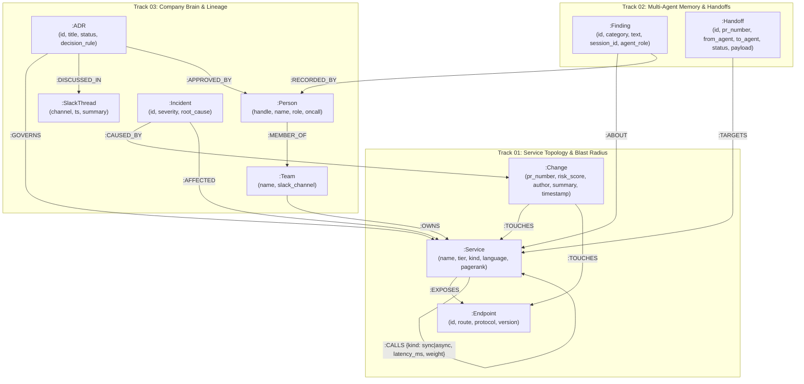

# CodePulse: Explainable Architecture, Company Brain & Multi-Agent Memory on FalkorDB

**CodePulse** is a zero-hallucination architectural blast-radius, organizational decision lineage (Company Brain GraphRAG), and multi-agent memory & governance platform powered by **FalkorDB**.

CodePulse unifies **all three hackathon tracks** into a single multi-tenant FalkorDB property graph (`codepulse:{tenant_id}`):
- **Track 01 — Multi-Hop Blast Radius & Dependency Intelligence:** Uncovers deep transitive service dependencies (`*1..4`), preserves parallel `sync` (gRPC) and `async` (Kafka) edges, computes weighted shortest failure chains, and ranks load-bearing services via `CALL algo.pageRank('Service', 'CALLS')`.
- **Track 02 — Persistent Agent Memory & Cross-Agent Handoffs:** Coordinates a 3-agent pipeline (`memory_scout` → `topology_analyst` → `release_governor`) using first-class `:Handoff` and `:Finding` nodes stored directly inside FalkorDB.
- **Track 03 — Company Brain GraphRAG & Decision Lineage:** Ingests Markdown ADRs, incident postmortems, and Slack threads into a locked graph ontology (`:ADR`, `:SlackThread`, `:Incident`, `:Team`, `:Person`, `:Endpoint`) to connect code changes (`PR #402`) to architectural rules (`ADR-014`) and active on-call responders.

---

## Core Architectural Guarantees

1. **Zero LLM-Written Cypher:** The LLM never writes raw Cypher. All graph reads and writes occur exclusively through **12 typed MCP tools** ([`mcp_server/server.py`](mcp_server/server.py)) backed by pre-baked, parameterized Cypher queries (`Q0`–`Q10` in [`db/queries.py`](db/queries.py)) with strict parameter clamping (`depth <= 4`, `limit <= 20`, `hours <= 168`).
2. **Deterministic Post-Generation Hallucination Guard ([`guard.py`](guard.py)):** Every sentence drafted by an agent is verified against the exact subgraph returned by FalkorDB via `accepts(draft, answer)`. Ungrounded service names, unverified hop claims, or fabricated ADRs are deterministically blocked and replaced with a graph-verified fallback.
3. **Honest Epistemics (4 Explicit Outcomes):** Every query resolves to one of four explicit epistemic states:
   - `Answered with Path` — Connected subgraph found and verified.
   - `Answered from Memory` — Recalled from a prior session's `:Finding` node in FalkorDB.
   - `Not in Graph` — Service exists in the catalog (`legacy-reporting`) but has `0` modelled edges; surfaces a visibility-gap warning instead of falsely claiming "zero impact".
   - `Unknown Entity` — Entity (`auth-gateway`) is not registered in the graph; caught by `Q0` (`resolve_entity`) with `0` graph traversals.
4. **Native Multi-Tenant Graph Isolation:** Uses `db.select_graph(f"codepulse:{tenant_id}")` to isolate `codepulse:fintech-prod` from `codepulse:sandbox-tenant` at the database level.

---

## Graph Data Model (Locked Ontology)

### Visual Schema Diagram



### Node Labels & Indexed Properties (11 Indexes)

| Node Label | Track | Indexed Properties | Key Attributes |
| :--- | :--- | :--- | :--- |
| `:Service` | Track 01 | `name`, `tier` | `name`, `tier`, `kind`, `language`, `pagerank` |
| `:Endpoint` | Track 01 | `id` | `id`, `route`, `protocol`, `version` |
| `:Change` | Track 01 / 03 | `pr_number`, `timestamp` | `pr_number`, `title`, `author`, `risk_score`, `summary`, `timestamp` |
| `:Team` | Track 03 | `name` | `name`, `slack_channel` |
| `:Person` | Track 03 | `handle` | `handle`, `name`, `role`, `oncall` |
| `:Incident` | Track 03 | `id` | `id`, `severity`, `summary`, `root_cause`, `timestamp` |
| `:ADR` | Track 03 | `id` | `id`, `title`, `status`, `decision_rule`, `date` |
| `:SlackThread` | Track 03 | `ts` | `ts`, `channel`, `author`, `summary` |
| `:Finding` | Track 02 | `id`, `created_at` | `id`, `category` (`episodic`\|`semantic`\|`procedural`), `text`, `session_id`, `agent_role`, `created_at` |
| `:Handoff` | Track 02 | `pr_number` | `id`, `pr_number`, `service`, `from_agent`, `to_agent`, `status`, `payload`, `updated_at` |

### Relationship Types (13 Locked Edge Types)

- `(:Service)-[:CALLS {kind, latency_ms, weight, endpoint}]->(:Service)` *(supports parallel `sync` gRPC and `async` Kafka edges)*
- `(:Service)-[:EXPOSES]->(:Endpoint)`
- `(:Team)-[:OWNS]->(:Service)`
- `(:Person)-[:MEMBER_OF]->(:Team)`
- `(:Change)-[:TOUCHES]->(:Service | :Endpoint)`
- `(:Incident)-[:CAUSED_BY]->(:Change)`
- `(:Incident)-[:AFFECTED]->(:Service)`
- `(:ADR)-[:GOVERNS]->(:Service)`
- `(:ADR)-[:DISCUSSED_IN]->(:SlackThread)`
- `(:ADR)-[:APPROVED_BY]->(:Person)`
- `(:Finding)-[:ABOUT]->(:Service)`
- `(:Finding)-[:RECORDED_BY]->(:Person)`
- `(:Handoff)-[:TARGETS]->(:Service)`

---

## Project Structure

```text
├── app.py                        # 3-Panel Streamlit Explainable War-Room UI
├── demo_harness.py               # 4-Move Judge Demo CLI Harness & UI View-Model Builder
├── guard.py                      # Deterministic Hallucination Guard (accepts / verify_or_fallback)
├── Dockerfile                    # Cloud Run production container definition
├── requirements.txt              # Locked Python dependencies
├── agents/
│   └── orchestrator.py           # 3-Agent Orchestrator (memory_scout -> topology_analyst -> release_governor)
├── mcp_server/
│   └── server.py                 # Typed MCP Server exposing 12 pre-baked graph tools (Zero raw Cypher)
├── db/
│   ├── connection.py             # Multi-tenant FalkorDB selector (codepulse:{tenant_id})
│   ├── schema.py                 # Idempotent 11-index schema bootstrap & EXPLAIN plan verifier
│   ├── seed.py                   # Golden fixture seeder for fintech-prod & sandbox-tenant
│   └── queries.py                # Pre-baked Cypher queries Q0-Q10 obeying all FalkorDB constraints
├── ingestion/
│   └── doc_ingestor.py           # Locked-ontology Markdown ingestor for ADRs, Postmortems, and Slack
├── docs/                         # Golden engineering corpus (ADR-014, ADR-015, INC-84, INC-99, Slack)
└── tests/                        # 29 TDD integration & unit tests across Tickets 01-06
```

---

## Local Setup & Quickstart

### 1. Create and Activate Virtual Environment

**Windows (PowerShell):**
```powershell
python -m venv .venv
.\.venv\Scripts\Activate.ps1
.\.venv\Scripts\pip.exe install -r requirements.txt
```

**macOS / Linux:**
```bash
python3 -m venv .venv
source .venv/bin/activate
pip install -r requirements.txt
```

### 2. Configure FalkorDB Environment Variables

Create a `.env` file in the root directory (or export environment variables):
```ini
FALKORDB_HOST=your-falkordb-host
FALKORDB_PORT=6379
FALKORDB_USERNAME=falkordb
FALKORDB_PASSWORD=your-password
```
*(If running FalkorDB locally via Docker: `docker run -p 6379:6379 -d falkordb/falkordb:latest` and set `FALKORDB_HOST=localhost`, `FALKORDB_PORT=6379`, `FALKORDB_USERNAME=""`, `FALKORDB_PASSWORD=""`.)*

### 3. Seed the Multi-Tenant Golden Graph
```powershell
$env:PYTHONPATH="."; .\.venv\Scripts\python.exe -m db.seed
```

### 4. Run the 29 Automated Tests
```powershell
$env:PYTHONPATH="."; .\.venv\Scripts\pytest.exe -v
```

### 5. Run the 4-Move Judge Demo CLI Harness
```powershell
$env:PYTHONPATH="."; .\.venv\Scripts\python.exe demo_harness.py
```

### 6. Launch the 3-Panel War-Room UI
```powershell
$env:PYTHONPATH="."; .\.venv\Scripts\streamlit.exe run app.py
```

---

## Cloud Run Deployment

CodePulse includes a production [`Dockerfile`](Dockerfile) configured to bind to Cloud Run's `$PORT` (default `8080`) and connect to your FalkorDB Cloud instance via environment variables.

```bash
gcloud run deploy codepulse-war-room \
  --source . \
  --region asia-south1 \
  --allow-unauthenticated \
  --set-env-vars="FALKORDB_HOST=YOUR_FALKORDB_HOST,FALKORDB_PORT=YOUR_FALKORDB_PORT,FALKORDB_USERNAME=falkordb,FALKORDB_PASSWORD=YOUR_FALKORDB_PASSWORD"
```
